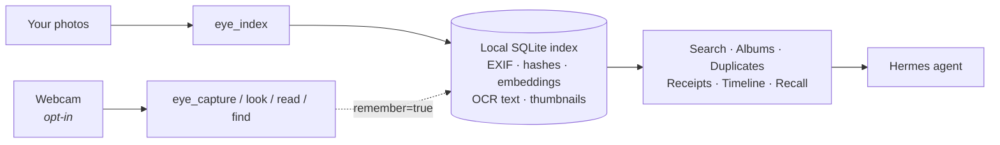

<div align="center">

# Hermes Eye Memory

A local photo index and search plugin for Hermes. Runs entirely on your machine.

[](https://github.com/isthatananya/hermes-eye-memory/actions/workflows/ci.yml)
[](https://github.com/NousResearch/hermes-agent/tree/main/plugin-catalog)
[](pyproject.toml)
[](plugin.yaml)
[](LICENSE)

```bash
hermes plugins install hermes-eye-memory
```

</div>

---

## What it does

Hermes Eye Memory indexes a photo folder into a local SQLite database (EXIF, hashes, embeddings, OCR text, thumbnails) and gives Hermes 16 tools to search and organize it. It can also use the webcam if you turn that on. There is no cloud vision API, upload, or account.

Example requests:

- "Find the photo of the red mug on the wooden table."
- "Which receipts did I photograph in May 2024?"
- "Make an album of the beach, best shots only."
- "What is on my desk right now?" (camera)
- "Where did I see this?" (camera to library)

## Install

Requires Hermes 0.22.0 or later.

```bash
hermes plugins install hermes-eye-memory
```

This installs the version pinned in the [Hermes plugin catalog](https://github.com/NousResearch/hermes-agent/tree/main/plugin-catalog). Hermes asks before installing Python dependencies.

<details>
<summary><b>Other ways to install</b></summary>

From a local checkout:

```bash
hermes plugins install /absolute/path/to/hermes-eye-memory
```

As a standalone CLI, no Hermes needed:

```bash
python -m pip install -e .
python -m hermes_eye_memory.cli index ~/Pictures
python -m hermes_eye_memory.cli search "red mug"
```

</details>

### Optional extras

The core install needs Pillow, NumPy, and reportlab. Python 3.11+ is required.

| Extra | Adds | Install |
| --- | --- | --- |
| `semantic` | CLIP search by meaning (fastembed) | `pip install -e ".[semantic]"` |
| `ocr` | Local text reading, receipt search (rapidocr) | `pip install -e ".[ocr]"` |
| `camera` | Webcam tools (opencv) | `pip install -e ".[camera]"` |
| `heic` | iPhone photos (pillow-heif) | `pip install -e ".[heic]"` |

Without the extras the plugin runs in fallback mode: color and composition search, filenames, notes, tags, EXIF, duplicates, albums, and timeline. If a model or camera package is unavailable, the related tool returns an error and the rest keep working.

> [!NOTE]
> Python 3.15 has no `onnxruntime` / `rapidocr-onnxruntime` wheels yet, so OCR and CLIP stay in fallback mode there. Use Python 3.11–3.13 for those extras.

## Quick start

```bash
# 1. Index a folder (re-runs skip unchanged files)
python -m hermes_eye_memory.cli index ~/Pictures --limit 2000

# 2. Search with natural language + filters
python -m hermes_eye_memory.cli search "dog on the beach" --limit 10
python -m hermes_eye_memory.cli search "tag:receipt year:2024"

# 3. Explore your library
python -m hermes_eye_memory.cli stats
python -m hermes_eye_memory.cli timeline --bucket month

# 4. Find near-duplicates and pick the best shot
python -m hermes_eye_memory.cli duplicates --threshold 6
python -m hermes_eye_memory.cli best "beach" --limit 5

# 5. Build a non-destructive album
python -m hermes_eye_memory.cli album "garden" --name garden-2024 --copy

# 6. Receipt report
python -m hermes_eye_memory.cli receipts --since 2024-01-01 --format markdown
```

To try it on a generated sample library:

```bash
python scripts/make_demo_library.py --out demo_library --clean
python -m hermes_eye_memory.cli index demo_library
python -m hermes_eye_memory.cli search "red mug"
```

See [docs/DEMO.md](docs/DEMO.md) for a full walkthrough.

## How it works



Originals are never modified. Everything lives in one local index. Details in [docs/ARCHITECTURE.md](docs/ARCHITECTURE.md).

## Tools

**Library**

| Tool | What it does |
| --- | --- |
| `eye_index` | Index a folder: EXIF, hashes, embeddings, thumbnails, optional OCR. Supports background jobs. |
| `eye_index_status` | Index health, coverage, data directory, background job state. |
| `eye_stats` | Totals, bytes, date range, OCR and embedding coverage. |
| `eye_forget` | Remove index entries. Never deletes original files; query removals are capped. |

**Find & organize**

| Tool | What it does |
| --- | --- |
| `eye_search` | Hybrid text, OCR, tag, date, folder, and visual search. |
| `eye_album` | Create a named album manifest; optionally copy files. |
| `eye_duplicates` | Group near-duplicates and bursts; suggest the best shot. |
| `eye_best` | Rank candidates by sharpness, exposure, and resolution. |
| `eye_timeline` | Counts by day, month, or year with examples. |
| `eye_receipts` | Extract merchant, date, and total; write PDF, Markdown, or CSV under the plugin data directory. |

**Camera** (off by default)

| Tool | What it does |
| --- | --- |
| `eye_capture` | Capture a webcam frame. Not stored unless `remember=true`. |
| `eye_look` | Describe the current camera view. |
| `eye_read` | Read text or a receipt with the camera. |
| `eye_find` | Capture the camera view and find similar library photos. |

**Memory**

| Tool | What it does |
| --- | --- |
| `eye_remember` | Attach a note, caption, or tags to a photo or search result. |
| `eye_recall` | Recall earlier camera frames and photos by text, tag, or time. |

**Search filters:** `year:2024` · `month:2024-05` · `day:2024-05-12` · `tag:receipt` · `is:receipt` · `has:ocr` · `has:gps` · `kind:photo|frame`. Quoted phrases stay together.

## Privacy and safety

- Photos stay on your machine. The plugin has no network code; the only download is the optional CLIP model on first use.
- OCR runs locally on CPU.
- The `eye_forget` tool only removes index rows and cannot delete original files. Query-based removals are capped by `max_forget_query`. The CLI can delete files with `--delete-files`, and `all=true` requires `confirm=true`.
- `eye_receipts` writes reports only under the plugin data directory and does not overwrite existing files.
- Camera tools are disabled until you set `camera_enabled`. Frames are not stored unless `remember=true`.
- Albums are manifests plus optional copies. They never move or delete originals.
- Background indexing runs one job at a time.

The index stores paths, EXIF, hashes, OCR text, captions, tags, and small thumbnails. See [docs/PRIVACY.md](docs/PRIVACY.md) for the full data inventory and threat model.

## Configuration

<details>
<summary><b>Plugin settings</b> (<code>plugin.yaml</code>)</summary>

| Key | Default | Meaning |
| --- | --- | --- |
| `library_path` | `""` | Default folder for `eye_index` and CLI commands. |
| `ocr_enabled` | `true` | Read text in photos. Slower; enables receipt search. |
| `embedding_backend` | `clip` | `clip` for semantic search, `fallback` for a no-download color/edge vector. |
| `camera_enabled` | `false` | Allow the camera tools to open the webcam. |
| `camera_index` | `0` | Default desktop camera. |
| `max_results` | `20` | Default result count. |
| `max_forget_query` | `20` | Max index entries one query-based `eye_forget` call may remove. |

</details>

<details>
<summary><b>Environment overrides</b></summary>

| Variable | Purpose |
| --- | --- |
| `HERMES_EYE_MEMORY_DATA` | Data directory for the SQLite index and thumbnails. |
| `HERMES_EYE_MEMORY_LIBRARY` | Default library folder. |
| `HERMES_EYE_MEMORY_OCR_ENABLED` | `true` / `false`. |
| `HERMES_EYE_MEMORY_EMBEDDING_BACKEND` | `clip` / `fallback`. |
| `HERMES_EYE_MEMORY_CAMERA_ENABLED` | `true` / `false`; camera tools are off by default. |
| `HERMES_EYE_MEMORY_CAMERA_INDEX` | Default camera index. |
| `HERMES_EYE_MEMORY_MAX_RESULTS` | Default result count. |
| `HERMES_EYE_MEMORY_MAX_FORGET_QUERY` | Max query-based index removals. |

The plugin uses Hermes's `plugin_db` and `plugin_data_dir` when available. Otherwise it stores data under `HERMES_HOME/plugin-data/hermes-eye-memory`.

</details>

<details>
<summary><b>Offline / fallback mode</b></summary>

CLIP gives the best results but downloads a model on first use. For an offline machine or a quick demo:

```bash
HERMES_EYE_MEMORY_EMBEDDING_BACKEND=fallback python -m hermes_eye_memory.cli index ~/Pictures
```

Fallback embeddings combine color histograms, a grayscale thumbnail, and a perceptual hash. Search still works for color, composition, OCR text, filenames, notes, and tags. It's not a replacement for CLIP semantics.

</details>

## Limitations

- Without the CLIP and OCR extras, search falls back to color, composition, filenames, notes, and tags.
- HEIC needs the `heic` extra.
- No video indexing. Camera frames are stills.
- Receipt parsing is heuristic: best-effort merchant, date, and total, not accounting-grade.
- Face recognition and people labeling are deliberately not included.

## Development

```bash
python -m pip install -e ".[dev]"
python -m pytest
```

Tests use `HERMES_EYE_MEMORY_EMBEDDING_BACKEND=fallback` with OCR disabled, so they need no model downloads and no camera. Install the optional extras before testing the OCR, CLIP, camera, or HEIC paths.

<details>
<summary>Windows: pytest can't create its temp directory?</summary>

```powershell
$env:TEMP = "C:\Users\you\AppData\Local\Temp"
python -m pytest
```

</details>

<details>
<summary>Validate before publishing a new version</summary>

```bash
hermes plugins doctor . --ci
hermes plugins validate . --install-deps
```

`doctor` loads `plugin.yaml`, calls `register(ctx)`, and compares declared tools with registered tools. `validate` runs the catalog checks. To ship an update to catalog users, open a PR to the Hermes repo that bumps the pinned `sha`. See [catalog/README.md](catalog/README.md).

</details>

---

<div align="center">

MIT licensed · Made by [@isthatananya](https://github.com/isthatananya) · [Report an issue](https://github.com/isthatananya/hermes-eye-memory/issues)

</div>
